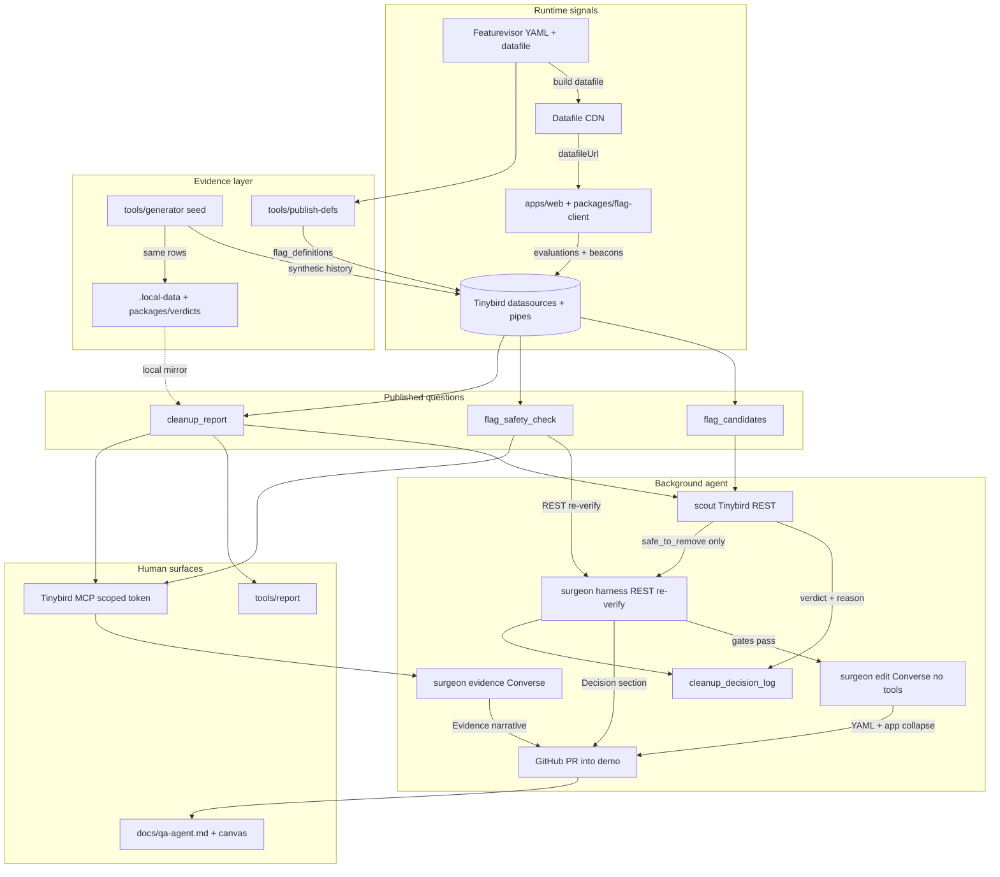
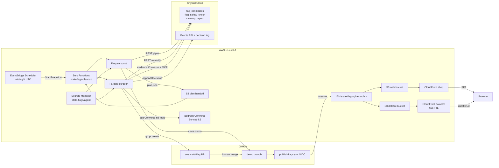
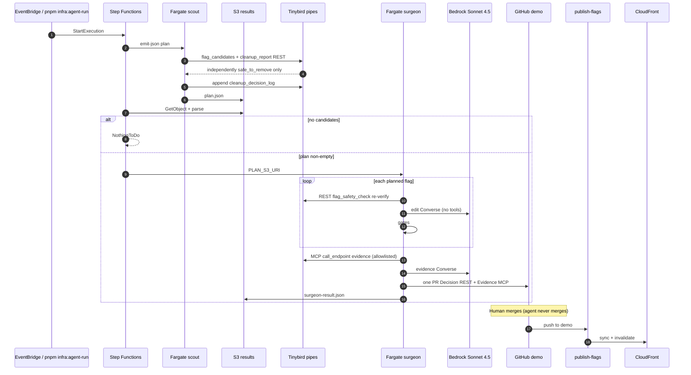

# Stale feature flag cleanup (PoC)

Background agent removes stale [Featurevisor](https://featurevisor.com) flags only after [Tinybird](https://www.tinybird.co) evidence says it is safe. Verdicts are ordered rules (SQL pipes in `tinybird/`, TypeScript mirror in `packages/verdicts`). Scout schedules. Surgeon collapses code and opens PRs into `demo`. Refusals are intentional.

All telemetry in this repository is **synthetic** (`tools/generator`).

Live demo (us-east-1):

| Surface | URL |
|---|---|
| Shop | https://dj37uarwx2jpn.cloudfront.net |
| Datafile | https://d1jcup3snfgsrs.cloudfront.net/featurevisor/production/featurevisor-all.json |

## Architecture (logical)



### Protocol rule

> Code talks to Tinybird over REST. Models and people talk to Tinybird over MCP.
> Every safety decision is taken by code, never by a model.

| Caller | Protocol | Can it decide safety? |
|---|---|---|
| Scout (deterministic) | REST | No (reads pipe verdicts; plans only) |
| Surgeon harness (`reverifyFlagSafety`) | REST | Yes (abort on drift; Decision section) |
| Surgeon editing model (`editLoop`) | none (no Tinybird tools) | No |
| Surgeon evidence model (post-gates Converse) | MCP (`TINYBIRD_MCP_TOKEN`) | No (narrative only) |
| Humans / editors | MCP | No (inspection) |

## Architecture (AWS us-east-1)



Split Fargate images: scout (REST only, no Bedrock, no MCP) and surgeon (REST re-verify + Bedrock edit without tools + MCP evidence narrative). Step Functions: Scout → Choice → one Surgeon session → Succeeded. Merge gate = GitHub PR notifications (no SNS).

## Sequence: nightly / on-demand cleanup



### How data moves

1. **Featurevisor** holds flag definitions; datafiles ship to S3/CloudFront.
2. **`apps/web` + `flag-client`** evaluate from that datafile.
3. **`publish-defs` / seed** populate Tinybird definitions + activity.
4. **Tinybird** pipes are the only eligibility API. Scout and surgeon harness call them over **REST**. The surgeon evidence model (and humans) use **Tinybird MCP**.
   Verdict order (PRD-08): structural checks → live minority / thin evidence → **then**
   lifecycle (`deprecated` / `archived`) → abandoned / settled. Deprecation is a request;
   evidence is the permission. Pitfall: before PRD-08, lifecycle sat above minority-build
   checks (PR #11 removed a still-live deprecated flag).
5. **Scout** plans independently `safe_to_remove` flags (`collapse_direction != none`) into S3 `plan.json`. It does not invent nest deletes for parent-gated inconclusive children.
6. **Surgeon** re-verifies each flag over REST, applies the whole plan in one Fargate session, then opens **one** PR only if every flag passes gates. Evidence narrative is a separate MCP-backed Converse call after gates.
7. **Humans** merge. Publish syncs CDN. QA: `docs/qa-agent.md`.

### What changed vs the first PoC sketch

| Area | Before | Now |
|---|---|---|
| Scout evidence | Local store / MCP-first | Tinybird REST only (`source=tinybird-rest`) |
| Surgeon | Per-flag Map | One Fargate session, one multi-flag PR; REST re-verify; MCP evidence narrative |
| Agent host | Early experiments | EventBridge → SFN → split ECS Fargate images |
| Merge notify | SNS stub | GitHub PR notifications |
| Model | n/a | Sonnet 4.5 Converse (edit without tools; evidence with MCP tools) |
| QA | Ad hoc | Production-bar playbook + new-flag E2E |

Refusals stay. Safe removals are whatever Tinybird marks safe. Current fixtures (PRD-08):
`catalog_clearance_rail` (abandoned / delete_gated), `checkout_trust_badges` (settled /
keep_gated), `nav_winter_ribbon` (deprecated but live minority → **blocked**). Earlier
pairs: `size_guide_panel` / `search_typo_suggest` (#11), `loyalty_stamp_banner` /
`express_pay_hint` (#9), `promo_banner_2025` / `one_click_buy` (#5/#6).

### Parts in this repo

| Part | Role |
|---|---|
| `featurevisor/` | Flag keys, rollout, parents, `deprecated` / `archived` |
| `packages/flag-client` | Featurevisor SDK wrapper, event batching, `datafileUrl` |
| `apps/web` | Northline demo shop |
| `tools/publish-datafile` | Build / publish datafile |
| `tools/publish-defs` | Definition snapshots → Tinybird |
| `tools/generator` | Synthetic seed + trickle |
| `tinybird/` | Datasources + the three pipes |
| `packages/verdicts` | TS mirror of safety rules + unit tests |
| `packages/local-store` | `.local-data` NDJSON + Tinybird truncate/append helpers |
| `agent/scout` | Tinybird-backed scout; `--emit-json` for Step Functions |
| `agent/surgeon` | REST re-verify + Bedrock edit (no tools) + MCP evidence + gates + PR |
| `docs/handoff-mcp-for-claude.md` | Protocol handoff for article / Claude |
| `tools/reset` | Reset `demo`, truncate Tinybird, reseed |
| `infra/` | CDK stack (web, datafiles, SFN + Fargate, scheduler, OIDC role) |
| `.github/workflows/publish-flags.yml` | Push to `main`/`demo` → S3 + CloudFront |
| `docs/qa-agent.md` | Manual QA agent playbook |

## Prerequisites

- Node.js >= 24, pnpm 10+
- Tinybird tokens for cloud path; AWS us-east-1 for CDN + Step Functions/ECS + Bedrock
- GitHub token with PR scope (Secrets Manager via `pnpm infra:secrets`)
- Bedrock model access for Sonnet 4.5 Converse in us-east-1

Copy `.env.example` to `.env` and adjust. Infra details: [`infra/README.md`](infra/README.md).

## Quickstart (local)

```bash
pnpm install
pnpm datafile:build
pnpm datafile:serve   # terminal 1
pnpm seed             # terminal 2 — 90-day synthetic history
pnpm publish-defs
pnpm report
SCOUT_SOURCE=tinybird pnpm agent:scout -- --dry-run
```

With removable fixtures present you should see independently `safe_to_remove` leaves (latest
pair was `size_guide_panel` + `search_typo_suggest`) plus refusals for wishlist / shipping /
`search_ranking_v2` / `checkout_redesign`. Scout logs `source=tinybird-rest`.

```bash
export VITE_DATAFILE_URL=http://127.0.0.1:4099/production/featurevisor-all.json
pnpm dev
```

## AWS demo loop

```bash
pnpm infra:deploy
pnpm infra:secrets
pnpm infra:sync
pnpm infra:agent-run          # Step Functions StartExecution; capture executionArn
# Follow docs/qa-agent.md → canvas report → merge PRs into demo
# If publish-flags GHA is not wired, run: pnpm infra:sync
```

Set GitHub secret `AWS_GHA_PUBLISH_ROLE_ARN` to stack output `GitHubPublishRoleArn` for automated publish after merge.

## MCP (Tinybird)

People and the surgeon **evidence** model use Tinybird MCP (`https://mcp.tinybird.co`).
Create a resource-scoped static token with READ on `flag_safety_check` and `cleanup_report`
only; put it in `TINYBIRD_MCP_TOKEN` (wired into `stale-flags/agent` for the surgeon task).
Scout and harness re-verify use `TINYBIRD_TOKEN` over REST, not MCP.

## Environment variables

See `.env.example`. Important ones:

| Var | Purpose |
|---|---|
| `VITE_DATAFILE_URL` | Remote Featurevisor datafile URL |
| `TINYBIRD_TOKEN` | REST for scout + surgeon harness |
| `TINYBIRD_MCP_TOKEN` | Surgeon evidence MCP (READ on two pipes) |
| `TINYBIRD_APPEND_TOKEN` | Event / decision log ingest |
| `SCOUT_SOURCE` | `tinybird` for cloud scout (REST); omit/local for `.local-data` |
| `BEDROCK_MODEL_ID` | Default Sonnet 4.5 inference profile |
| `BEDROCK_DISABLED` | `1` forces heuristic surgeon edits |
| `GITHUB_TOKEN` / `DEMO_BRANCH` | PRs against `demo` |
| `OLLAMA_*` | Optional local PR prose |

## Agent commands

```bash
SCOUT_SOURCE=tinybird pnpm agent:scout -- --dry-run
pnpm agent:run
pnpm agent:surgeon -- --flag=search_ranking_v2 --dry-run
pnpm demo:reset
pnpm infra:agent-run
```

## Repo layout

```
apps/web                 React + Vite demo shop
packages/flag-client     Featurevisor wrapper + event emission
packages/verdicts        Safety-check rules (+ tests)
packages/local-store     Local NDJSON + Tinybird helpers
featurevisor             Flag YAML
tinybird                 Datasources + pipes
tools/*                  seed, report, publish-*, reset
agent/scout|surgeon      Background agent (REST / MCP per PRD-07)
infra                    AWS CDK (us-east-1)
.github/workflows        publish-flags OIDC sync
docs/qa-agent.md         Manual QA playbook
docs/handoff-mcp-for-claude.md   Protocol handoff for article / Claude
docs/captures/article-2026-10/   Real browser captures + INDEX
prds/PRD-07-protocol-alignment.md
```
