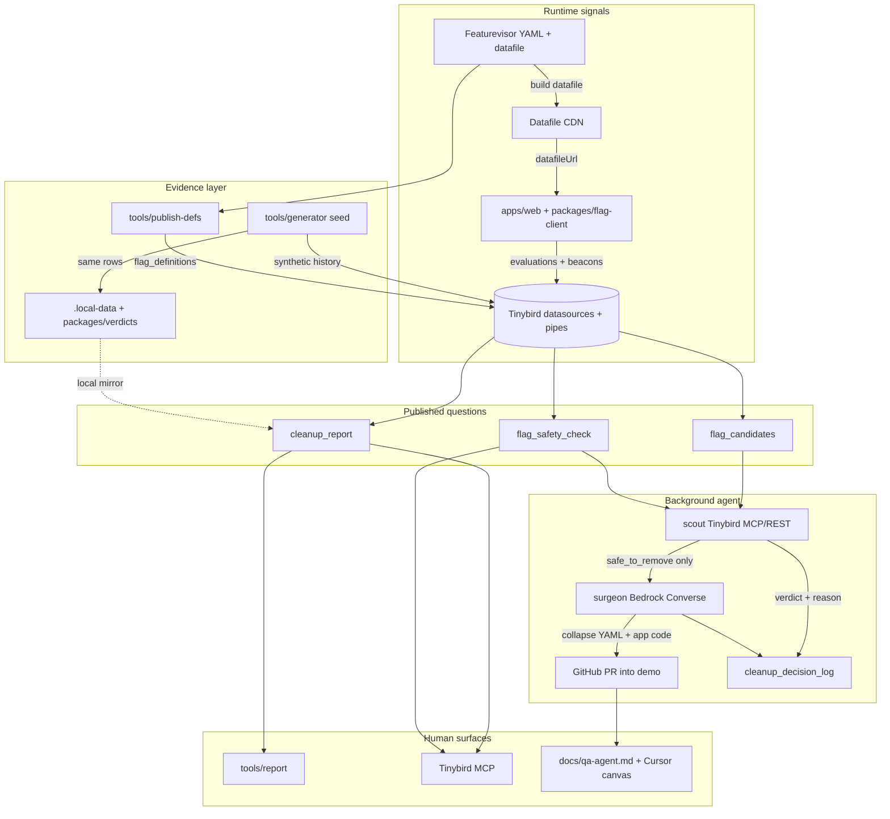
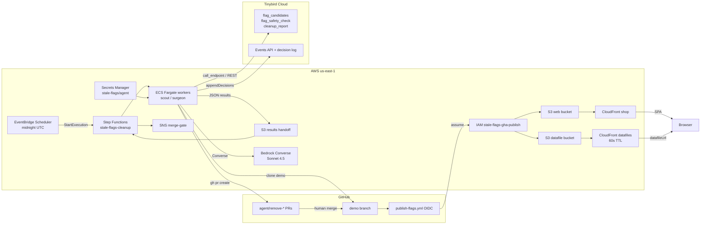

# Stale feature flag cleanup (PoC)

Background agent removes stale [Featurevisor](https://featurevisor.com) flags only after [Tinybird](https://www.tinybird.co) evidence says it is safe. Verdicts are ordered rules (SQL pipes in `tinybird/`, TypeScript mirror in `packages/verdicts`). Scout schedules. Surgeon collapses code and opens PRs into `demo`. Refusals are intentional.

All telemetry in this repository is **synthetic** (`tools/generator`).

Live demo (us-east-1):

| Surface | URL |
|---|---|
| Shop | https://dj37uarwx2jpn.cloudfront.net |
| Datafile | https://d1jcup3snfgsrs.cloudfront.net/featurevisor/production/featurevisor-all.json |

## Architecture (logical)



## Architecture (AWS us-east-1)



ECS Fargate is the agent host (git, pnpm, ripgrep, Bedrock). Step Functions owns Scout → Choice → Map(Surgeon) → Notify. It is not a zip Lambda.

## Sequence: nightly / on-demand cleanup

```mermaid
sequenceDiagram
  autonumber
  participant Sch as EventBridge / pnpm infra:agent-run
  participant SFN as Step Functions
  participant Scout as Fargate scout
  participant S3 as S3 results
  participant TB as Tinybird pipes
  participant Surg as Fargate surgeon
  participant Bedrock as Bedrock Sonnet 4.5
  participant GH as GitHub demo
  participant SNS as SNS merge-gate
  participant GHA as publish-flags
  participant CDN as CloudFront

  Sch->>SFN: StartExecution
  SFN->>Scout: AGENT_ROLE=scout --emit-json --no-dispatch
  Scout->>Scout: clone demo, pnpm install, build workspace pkgs
  Scout->>TB: flag_candidates + cleanup_report / flag_safety_check
  TB-->>Scout: verdicts + collapse_direction
  Scout->>TB: append cleanup_decision_log
  Scout->>S3: scout.json candidates + payload_b64
  SFN->>S3: GetObject + parse
  alt no candidates
    SFN-->>SFN: NothingToDo
  else safe_to_remove present
    loop Map MaxConcurrency 1
      SFN->>Surg: FLAG_KEY + SURGEON_PAYLOAD_B64
      Surg->>Bedrock: Converse edit loop (heuristic fallback)
      Bedrock-->>Surg: file contents
      Surg->>Surg: gates tsc vite featurevisor rg allowlist
      Surg->>GH: commit + PR into demo
      Surg->>TB: append decision with pr_url
      Surg->>S3: surgeon-FLAG.json
    end
    SFN->>SNS: merge-gate notice (no auto-merge)
  end
  Note over GH: Human merges PRs (agent never merges)
  GH->>GHA: push to demo
  GHA->>CDN: sync datafile + web + invalidate
  Note over CDN: Listing loses promo UI;<br/>Checkout keeps One-click buy CTA
```

### How data moves

1. **Featurevisor** holds flag definitions (`featurevisor/features/*.yml`), including `deprecated` / `archived` and parent/child links. Built **datafiles** ship to S3/CloudFront (`pnpm infra:sync` or `publish-flags.yml`).
2. **`apps/web` + `flag-client`** evaluate flags from that datafile. In this PoC, history is mostly **synthetic** from the generator; the shop proves the client path and post-cleanup UI.
3. **`publish-defs`** snapshots YAML into `flag_definitions` (rollout %, `target_value`, lifecycle). Collapse direction comes from definitions, not from guessing in code.
4. **`tools/generator`** seeds ~90 days of activity so all eight demo verdicts reproduce.
5. **Tinybird** exposes three pipes: `flag_candidates`, `flag_safety_check`, `cleanup_report`. Scout prefers Tinybird MCP `call_endpoint`, with REST fallback.
6. **Scout** (Fargate) logs decisions to `cleanup_decision_log` and writes `safe_to_remove` candidates to S3 (`--emit-json --no-dispatch`). Step Functions does not spawn surgeons from scout process exit codes.
7. **Surgeon** (Fargate Map item) asks **Bedrock Converse** (Sonnet 4.5) to edit app call sites, with a deterministic heuristic fallback. It deletes Featurevisor YAML, runs gates (tsc, vite, featurevisor lint/test, leftover `rg`, path allowlist), then opens a PR against **`demo` only** and writes a result JSON to S3.
8. **SNS** publishes a merge-gate notice. **Humans** merge. Publish syncs CDN. QA playbook: `docs/qa-agent.md` (Cursor canvas per run).

### What changed vs the first PoC sketch

| Area | Before | Now |
|---|---|---|
| Scout evidence | Local `.local-data` / TS verdicts | Tinybird MCP + REST pipes (TS mirror kept for offline) |
| Surgeon edits | Hardcoded Listing/Checkout paths | Bedrock Converse loop + heuristic fallback |
| Surgeon PR prose | Ollama optional | Fallback PR body from payload (Ollama still optional locally) |
| Agent host | CodeBuild + Scheduler | EventBridge → Step Functions → ECS Fargate + S3 result handoff + SNS merge-gate |
| Model | n/a | `us.anthropic.claude-sonnet-4-5-20250929-v1:0` |
| Publish path | Manual sync | `.github/workflows/publish-flags.yml` (OIDC) + `pnpm infra:sync` fallback |
| Decision log | Local NDJSON | Tinybird `cleanup_decision_log` (truncate on seed/reset) |
| QA | Ad hoc | `docs/qa-agent.md` + Cursor canvas reports |

Refusals (`blocked`, `inconclusive`) stay. Only `promo_banner_2025` (`delete_gated_branch`) and `one_click_buy` (`keep_gated_branch`) become PRs.

### Parts in this repo

| Part | Role |
|---|---|
| `featurevisor/` | Flag keys, rollout, parents, `deprecated` / `archived` |
| `packages/flag-client` | Featurevisor SDK wrapper, event batching, `datafileUrl` |
| `apps/web` | Northline demo shop |
| `tools/publish-datafile` | Build / publish datafile |
| `tools/publish-defs` | Definition snapshots → Tinybird |
| `tools/generator` | Synthetic seed + trickle |
| `tinybird/` | Datasources + the three pipes |
| `packages/verdicts` | TS mirror of safety rules + unit tests |
| `packages/local-store` | `.local-data` NDJSON + Tinybird truncate/append helpers |
| `agent/scout` | Tinybird-backed scout; `--emit-json` for Step Functions |
| `agent/surgeon` | Bedrock (or heuristic) collapse + gates + PR |
| `tools/reset` | Reset `demo`, truncate Tinybird, reseed |
| `infra/` | CDK stack (web, datafiles, SFN + Fargate, scheduler, OIDC role) |
| `.github/workflows/publish-flags.yml` | Push to `main`/`demo` → S3 + CloudFront |
| `docs/qa-agent.md` | Manual QA agent playbook |

## Prerequisites

- Node.js >= 24, pnpm 10+
- Tinybird tokens for cloud path; AWS us-east-1 for CDN + Step Functions/ECS + Bedrock
- GitHub token with PR scope (Secrets Manager via `pnpm infra:secrets`)
- Bedrock model access for Sonnet 4.5 Converse in us-east-1

Copy `.env.example` to `.env` and adjust. Infra details: [`infra/README.md`](infra/README.md).

## Quickstart (local)

```bash
pnpm install
pnpm datafile:build
pnpm datafile:serve   # terminal 1
pnpm seed             # terminal 2 — 90-day synthetic history
pnpm publish-defs
pnpm report
SCOUT_SOURCE=tinybird pnpm agent:scout -- --dry-run
```

You should see `promo_banner_2025` and `one_click_buy` as `safe_to_remove`, and refusals for the other six.

```bash
export VITE_DATAFILE_URL=http://127.0.0.1:4099/production/featurevisor-all.json
pnpm dev
```

## AWS demo loop

```bash
pnpm infra:deploy
pnpm infra:secrets
pnpm infra:sync
pnpm infra:agent-run          # Step Functions StartExecution; capture executionArn
# Follow docs/qa-agent.md → canvas report → merge PRs into demo
# If publish-flags GHA is not wired, run: pnpm infra:sync
```

Set GitHub secret `AWS_GHA_PUBLISH_ROLE_ARN` to stack output `GitHubPublishRoleArn` for automated publish after merge.

## MCP (Tinybird)

Scope a token to the three endpoints and add Tinybird MCP in the editor. Scout on Fargate uses the same `call_endpoint` path when `TINYBIRD_TOKEN` is present.

## Environment variables

See `.env.example`. Important ones:

| Var | Purpose |
|---|---|
| `VITE_DATAFILE_URL` | Remote Featurevisor datafile URL |
| `TINYBIRD_*` | Cloud ingest / pipe API / MCP |
| `SCOUT_SOURCE` | `tinybird` / `mcp` for cloud scout |
| `BEDROCK_MODEL_ID` | Default Sonnet 4.5 inference profile |
| `BEDROCK_DISABLED` | `1` forces heuristic surgeon edits |
| `GITHUB_TOKEN` / `DEMO_BRANCH` | PRs against `demo` |
| `OLLAMA_*` | Optional local PR prose |

## Agent commands

```bash
SCOUT_SOURCE=tinybird pnpm agent:scout -- --dry-run
pnpm agent:run
pnpm agent:surgeon -- --flag=promo_banner_2025 --dry-run
pnpm demo:reset
pnpm infra:agent-run
```

## Repo layout

```
apps/web                 React + Vite demo shop
packages/flag-client     Featurevisor wrapper + event emission
packages/verdicts        Safety-check rules (+ tests)
packages/local-store     Local NDJSON + Tinybird helpers
featurevisor             Flag YAML
tinybird                 Datasources + pipes
tools/*                  seed, report, publish-*, reset
agent/scout|surgeon      Background agent
infra                    AWS CDK (us-east-1)
.github/workflows        publish-flags OIDC sync
docs/qa-agent.md         Manual QA playbook
```
