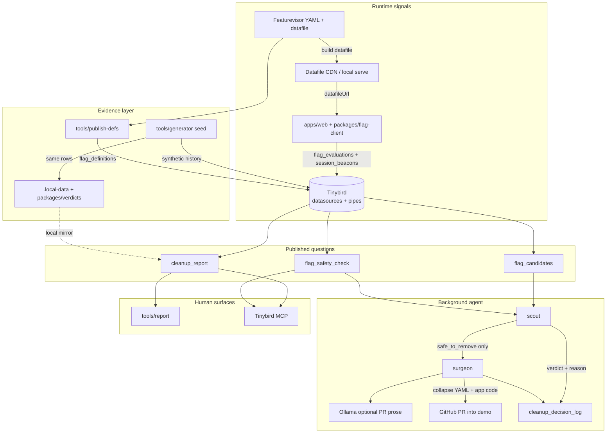

# Stale feature flag cleanup (PoC)

Background agent removes stale [Featurevisor](https://featurevisor.com) flags only after [Tinybird](https://www.tinybird.co)-shaped evidence says it is safe. Verdicts are computed by ordered rules (SQL endpoints in `tinybird/`, TypeScript mirror in `packages/verdicts` for local runs). The agent executes them. Refusals are the point of the demo.

All telemetry in this repository is **synthetic**. The generator is in `tools/generator`.

## Architecture



### How data moves

1. **Featurevisor** holds flag definitions (`featurevisor/features/*.yml`), including `deprecated` / `archived` and parent/child links. A built **datafile** is served remotely (S3/CloudFront in prod, `pnpm datafile:serve` locally).
2. **`apps/web` + `flag-client`** evaluate flags from that datafile and emit evaluation events and session beacons (with `build_id`). In this PoC, telemetry is mostly **synthetic** from the generator; the web app proves the client path.
3. **`publish-defs`** snapshots Featurevisor YAML into `flag_definitions` (rollout %, target value, lifecycle flags). That is what the agent uses for collapse direction. It must not guess from code.
4. **`tools/generator`** seeds ~90 days of `flag_daily_activity` and `build_adoption` so all eight demo verdicts reproduce. Same rules apply locally via `.local-data` and `packages/verdicts`.
5. **Tinybird** stores the joined evidence and exposes only three pipes as APIs: candidates, safety check, cleanup report. The agent is not given raw warehouse access.
6. **Scout** reads those answers (or the local verdict mirror), writes every decision to `cleanup_decision_log`, and only dispatches **surgeon** for `safe_to_remove`.
7. **Surgeon** collapses Featurevisor YAML and app call sites deterministically, optionally asks Ollama for PR prose, runs validation/security checks, and opens a PR against **`demo`** only (never `main`).
8. **Humans** use `pnpm report`, the Tinybird UI, or MCP (`cleanup_report` / `flag_safety_check`) to inspect the same verdicts the agent executes.

### Parts in this repo

| Part | Role |
|---|---|
| `featurevisor/` | Source of truth for flag keys, rollout, parents, `deprecated` / `archived` |
| `packages/flag-client` | Featurevisor SDK wrapper, event batching, `datafileUrl` load |
| `apps/web` | Northline demo shop that evaluates flags and shows callouts |
| `tools/publish-datafile` | Build/serve/publish the datafile (local CDN stand-in or S3) |
| `tools/publish-defs` | Push definition snapshots into Tinybird / print NDJSON |
| `tools/generator` | Synthetic seed + trickle traffic for the eight-flag matrix |
| `tinybird/` | Datasources, MV, and `flag_candidates` / `flag_safety_check` / `cleanup_report` |
| `packages/verdicts` | TypeScript mirror of the safety rules for offline `pnpm report` / agent |
| `packages/local-store` | `.local-data` NDJSON + optional Tinybird Events ingest |
| `packages/defs-utils` | Shared `target_value` / collapse direction helpers |
| `tools/report` | CLI table of verdicts from local store |
| `agent/scout` | Deterministic scheduler: candidates → verdict → log → dispatch |
| `agent/surgeon` | Code + YAML collapse, optional Ollama text, PR to `demo` |
| `tools/reset` | Reset `demo` to `demo-clean`, reseed, republish |
| `infra/` | Notes for later AWS / AgentCore hosting |
| `docs/` | Capture checklist and sample artefacts for the article |

Refusals (`blocked`, `inconclusive`) are intentional demo outcomes. Only `promo_banner_2025` (delete gated branch) and `one_click_buy` (keep gated branch) should become PRs.

## Prerequisites

- Node.js >= 24, pnpm 10+
- Optional: Tinybird token (cloud ingest), AWS (datafile CDN), GitHub token (real PRs)
- Optional for surgeon PR text: [Ollama](https://ollama.com) with `qwen3:8b` (or set `OLLAMA_MODEL`). Set `OLLAMA_DISABLED=1` to skip.

Copy `.env.example` to `.env` and adjust.

## Quickstart (clone → see a refusal)

```bash
pnpm install
pnpm datafile:build
pnpm datafile:serve   # terminal 1 — CDN stand-in
pnpm seed             # terminal 2 — 90-day synthetic history → .local-data/
pnpm publish-defs     # prints or posts flag_definitions
pnpm report           # table of eight flags + verdicts
pnpm agent:scout -- --dry-run
```

You should see `promo_banner_2025` and `one_click_buy` as `safe_to_remove` (Featurevisor `deprecated: true`), and refusals for `checkout_redesign`, `shipping_estimator`, `wishlist`, wishlist children, and `search_ranking_v2`.

Run the web app (with datafile server up):

```bash
export VITE_DATAFILE_URL=http://127.0.0.1:4099/production/featurevisor-all.json
pnpm dev
```

## MCP (Tinybird)

When the Tinybird project is deployed, scope a token to the three endpoints only and add the Tinybird MCP server in your editor. Ask which flags are queued tonight; answers should come from `cleanup_report` / `flag_safety_check` with sentence `reason` fields.

Local demos use `pnpm report` against `.local-data` (same verdict rules).

## Environment variables

See `.env.example`. Important ones:

| Var | Purpose |
|---|---|
| `VITE_DATAFILE_URL` | Remote Featurevisor datafile URL |
| `TINYBIRD_*` | Optional cloud ingest / API |
| `OLLAMA_HOST` / `OLLAMA_MODEL` | Surgeon PR body generation |
| `GITHUB_TOKEN` / `DEMO_BRANCH` | Real PRs against `demo` |

## Agent commands

```bash
pnpm agent:scout -- --dry-run
pnpm agent:run          # writes cleanup_decision_log + dispatches surgeons
pnpm agent:surgeon -- --flag=promo_banner_2025 --dry-run
pnpm demo:reset         # reset demo branch tag + republish + reseed
```

## Repo layout

```
apps/web                 React + Vite demo shop
packages/flag-client     Featurevisor wrapper + event emission
packages/verdicts        Safety-check rules (local mirror of Tinybird intent)
packages/defs-utils      target_value / collapse_direction derivation
featurevisor             Flag YAML (promo + one_click are deprecated)
tinybird                 Datasources + pipes
tools/*                  seed, report, publish-defs, publish-datafile, reset
agent/scout|surgeon      Background agent
infra                    AWS notes (AgentCore later)
docs/capture-checklist.md
```
