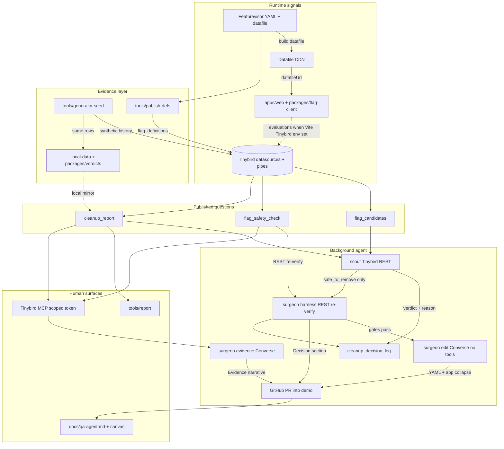
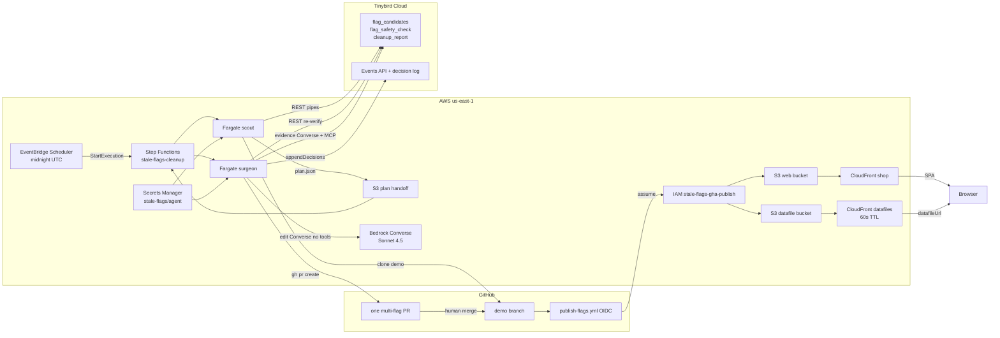
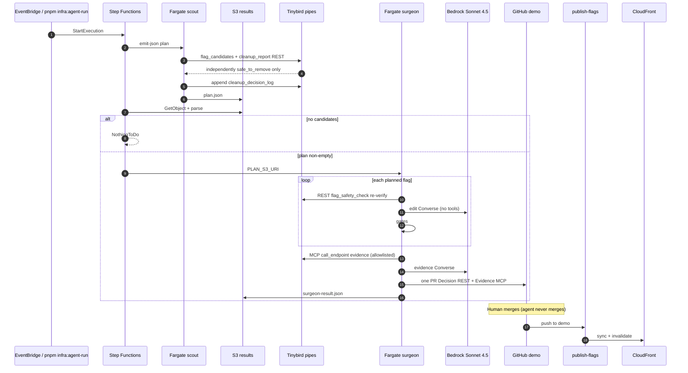

# Stale feature flag cleanup (PoC)

Background agent removes stale [Featurevisor](https://featurevisor.com) flags only after [Tinybird](https://www.tinybird.co) evidence says it is safe. Verdicts are ordered rules (SQL pipes in `tinybird/`, TypeScript mirror in `packages/verdicts`). Scout schedules. Surgeon collapses code and opens PRs into `demo`. Refusals are intentional.

All telemetry that drives scout/surgeon decisions is **synthetic** (`tools/generator` →
`flag_evaluations` → MV → `flag_daily_activity`). The CloudFront shop may ship
`VITE_TINYBIRD_BROWSER_EVENTS_TOKEN` (scoped to evaluations + beacons only). FlagCallout
text like `off · evaluated` means the SDK ran locally; live streaming needs those Vite
env vars set at build time.

Live demo (us-east-1):

| Surface | URL |
|---|---|
| Shop | https://dj37uarwx2jpn.cloudfront.net |
| Datafile | https://d1jcup3snfgsrs.cloudfront.net/featurevisor/production/featurevisor-all.json |

## Architecture (logical)



### Protocol rule

> Code talks to Tinybird over REST. Models and people talk to Tinybird over MCP.
> Every safety decision is taken by code, never by a model.

| Caller | Protocol | Can it decide safety? |
|---|---|---|
| Scout (deterministic) | REST | No (reads pipe verdicts; plans only) |
| Surgeon harness (`reverifyFlagSafety`) | REST | Yes (abort on drift; Decision section) |
| Surgeon editing model (`editLoop`) | none (no Tinybird tools) | No |
| Surgeon evidence model (post-gates Converse) | MCP (`TINYBIRD_MCP_TOKEN`) | No (narrative only) |
| Humans / editors | MCP | No (inspection) |

## Architecture (AWS us-east-1)



Split Fargate images: scout (REST only, no Bedrock, no MCP) and surgeon (REST re-verify + Bedrock edit without tools + MCP evidence narrative). Step Functions: Scout → Choice → one Surgeon session → Succeeded. Merge gate = GitHub PR notifications (no SNS).

## Sequence: nightly / on-demand cleanup



### How data moves

1. **Featurevisor** holds flag definitions; datafiles ship to S3/CloudFront.
2. **`apps/web` + `flag-client`** evaluate from that datafile.
3. **`publish-defs` / seed** populate Tinybird definitions + activity.
4. **Tinybird** pipes are the only eligibility API. Scout and surgeon harness call them over **REST**. The surgeon evidence model (and humans) use **Tinybird MCP**.
   Verdict order (PRD-08): structural checks → thin evidence / first-seen → live minority →
   **then** lifecycle (`deprecated` / `archived`) → abandoned / settled. Deprecation is a request;
   evidence is the permission. `evaluating_share` is a fraction in `[0, 1]` (latest adoption
   snapshot per evaluating build). Pitfalls: lifecycle used to sit above evidence checks;
   PR #11's narrative misreported a summed metric as a percentage.
5. **Scout** plans independently `safe_to_remove` flags (`collapse_direction != none`) into S3 `plan.json`. It does not invent nest deletes for parent-gated inconclusive children.
6. **Surgeon** re-verifies each flag over REST, applies the whole plan in one Fargate session, then opens **one** PR only if every flag passes gates. Evidence narrative is a separate MCP-backed Converse call after gates.
7. **Humans** merge. Publish syncs CDN. QA: `docs/qa-agent.md`.

### What changed vs the first PoC sketch

| Area | Before | Now |
|---|---|---|
| Scout evidence | Local store / MCP-first | Tinybird REST only (`source=tinybird-rest`) |
| Surgeon | Per-flag Map | One Fargate session, one multi-flag PR; REST re-verify; MCP evidence narrative |
| Agent host | Early experiments | EventBridge → SFN → split ECS Fargate images |
| Merge notify | SNS stub | GitHub PR notifications |
| Model | n/a | Sonnet 4.5 Converse (edit without tools; evidence with MCP tools) |
| QA | Ad hoc | Production-bar playbook + new-flag E2E |

Refusals stay. Safe removals are whatever Tinybird marks safe. Current seed (no
`safe_to_remove` fixtures): `wishlist` (+ children, descendants / parent-gated),
`shipping_estimator` (mid-ramp), `search_ranking_v2` (thin), `checkout_redesign` and
`nav_winter_ribbon` (live minority; ribbon is also deprecated). Earlier removed pairs:
`listing_outlet_banner` / `checkout_secure_seal` (#14), `catalog_clearance_rail` /
`checkout_trust_badges` (#12), `promo_banner_2025` / `one_click_buy` (#5/#6).

### Parts in this repo

| Part | Role |
|---|---|
| `featurevisor/` | Flag keys, rollout, parents, `deprecated` / `archived` |
| `packages/flag-client` | Featurevisor SDK wrapper, event batching, `datafileUrl` |
| `apps/web` | Northline demo shop |
| `tools/publish-datafile` | Build / publish datafile |
| `tools/publish-defs` | Definition snapshots → Tinybird |
| `tools/generator` | Synthetic seed + trickle |
| `tinybird/` | Datasources + the three pipes |
| `packages/verdicts` | TS mirror of safety rules + unit tests |
| `packages/local-store` | `.local-data` NDJSON + Tinybird truncate/append helpers |
| `agent/scout` | Tinybird-backed scout; `--emit-json` for Step Functions |
| `agent/surgeon` | REST re-verify + Bedrock edit (no tools) + MCP evidence + gates + PR |
| `docs/handoff-mcp-for-claude.md` | Protocol handoff for article / Claude |
| `tools/reset` | Reset `demo`, truncate Tinybird, reseed |
| `infra/` | CDK stack (web, datafiles, SFN + Fargate, scheduler, OIDC role) |
| `.github/workflows/publish-flags.yml` | Push to `demo` only → S3 + CloudFront |
| `docs/qa-agent.md` | Manual QA agent playbook |

## Run it yourself

Reproduce the PoC end to end. Evidence pipes deploy with the Tinybird CLI; the agent host is
ECS Fargate under Step Functions (not CodeBuild). More infra detail: [`infra/README.md`](infra/README.md).
Tinybird token notes: [`tinybird/README.md`](tinybird/README.md).

### Prerequisites

| Need | Why |
|---|---|
| Node.js ≥ 24, pnpm 10+ | Monorepo install and agents |
| [Tinybird CLI](https://www.tinybird.co/docs/get-started/quick-start) (`tb`) + a workspace | Datasources, pipes, Events API |
| AWS account in **us-east-1** with CDK bootstrap rights, Docker, and **Bedrock** access to Claude Sonnet 4.5 | CloudFront shop/datafiles, Step Functions, Fargate scout/surgeon |
| GitHub personal access token with `repo` (PR create/push) | Surgeon opens PRs into `demo` |
| AWS CLI configured (`aws sts get-caller-identity` works) | Deploy and `infra:agent-run` |

Optional for a live shop that posts evaluations: set `VITE_TINYBIRD_API_HOST` and
`VITE_TINYBIRD_BROWSER_EVENTS_TOKEN` before `pnpm infra:sync`. That token can only append
to `flag_evaluations` and `session_beacons` (see [`tinybird/README.md`](tinybird/README.md)).

### Permissions

| Surface | Rule |
|---|---|
| Agent `GITHUB_TOKEN` | Fine-grained PAT on this repo only: Contents write + Pull requests write. No admin. |
| Branch protection | `main` and `demo` require a PR + one approving review; force-push and deletion blocked; the agent token cannot bypass |
| Publishing | Only **`demo`** runs `publish-flags.yml` and may assume `stale-flags-gha-publish` (OIDC `sub` pinned to `ref:refs/heads/demo`) |
| Agent merge | The agent opens PRs into `demo`; it never merges. Humans approve and merge |

### Cloud path (ordered)

```bash
git clone https://github.com/lucamezzalira/stale-flag-cleanup.git
cd stale-flag-cleanup
pnpm install
pnpm --filter "./packages/**" run build   # workspace dist/ needed by seed + agents
cp .env.example .env
```

1. **Log in to Tinybird and deploy the project**

```bash
tb login
cd tinybird && tb --cloud deploy --wait && cd ..
```

Use the region host that matches your workspace (this PoC uses
`https://api.us-east.aws.tinybird.co`). Set `TINYBIRD_API_HOST` in `.env` to that host.

2. **Copy scoped Tinybird tokens into `.env`**

After deploy, list tokens and fill every writer (do not reuse one value for all):

```bash
tb --cloud --show-tokens token ls
```

| Env var | Token name |
|---|---|
| `TINYBIRD_TOKEN` | `endpoint_read` |
| `TINYBIRD_BROWSER_EVENTS_TOKEN` (+ `VITE_…`) | `browser_events` |
| `TINYBIRD_DEFS_TOKEN` | `defs_publisher` |
| `TINYBIRD_ADOPTION_TOKEN` | `adoption_writer` |
| `TINYBIRD_DECISION_TOKEN` | `decision_writer` |
| `TINYBIRD_MCP_TOKEN` | `surgeon_mcp_evidence` |

Also set `GITHUB_TOKEN` (and optionally `GITHUB_REPO` / `DEMO_BRANCH=demo`) in `.env`.

3. **Push secrets, then deploy AWS**

```bash
pnpm infra:secrets                 # Writes Secrets Manager stale-flags/agent from .env
pnpm infra:bootstrap               # Once per account/region
pnpm infra:deploy                  # Needs Docker; builds scout + surgeon images
pnpm infra:sync                    # Shop SPA + Featurevisor datafile → S3/CloudFront
```

4. **Seed synthetic history and dry-run scout**

```bash
pnpm seed
SCOUT_SOURCE=tinybird pnpm agent:scout -- --dry-run
```

You should see `source=tinybird-rest` and a refusal matrix matching the seed: `wishlist`
(+ children), `shipping_estimator`, `search_ranking_v2`, `checkout_redesign`,
`nav_winter_ribbon`. Proposed surgeon actions stay empty until you add a
`safe_to_remove` fixture. Tokens come from `.env` (scout loads it). If a pipe looks empty
right after seed, wait a few seconds and re-run scout (Events API ingest lag). To run the
full Fargate loop:

```bash
pnpm infra:agent-run               # Prints Step Functions executionArn
```

Then follow [`docs/qa-agent.md`](docs/qa-agent.md): merge the agent PR into `demo`, publish
(GHA or `pnpm infra:sync`). Set GitHub Actions secret `AWS_GHA_PUBLISH_ROLE_ARN` to stack
output `GitHubPublishRoleArn` if you want merge-triggered publish.

### Local-only (no AWS)

```bash
pnpm install
pnpm --filter "./packages/**" run build
cp .env.example .env               # Fill Tinybird tokens if you want cloud pipes
pnpm datafile:build
pnpm datafile:serve                # Terminal 1
pnpm seed && pnpm publish-defs     # Terminal 2
SCOUT_SOURCE=tinybird pnpm agent:scout -- --dry-run
export VITE_DATAFILE_URL=http://127.0.0.1:4099/production/featurevisor-all.json
pnpm dev
```

Without Tinybird tokens, `pnpm seed` still writes `.local-data/` and local verdicts work;
cloud scout/surgeon need the tokens above. Protocol table is under **Protocol rule** above.

## Environment variables

See `.env.example`. Important ones:

| Var | Purpose |
|---|---|
| `VITE_DATAFILE_URL` | Remote Featurevisor datafile URL |
| `TINYBIRD_TOKEN` | REST read for scout + surgeon harness |
| `TINYBIRD_MCP_TOKEN` | Surgeon evidence MCP (READ on two pipes) |
| `TINYBIRD_BROWSER_EVENTS_TOKEN` | Browser APPEND (evaluations + beacons) |
| `TINYBIRD_DEFS_TOKEN` | publish-defs APPEND |
| `TINYBIRD_ADOPTION_TOKEN` | Seed APPEND to `build_adoption` |
| `TINYBIRD_DECISION_TOKEN` | Scout/surgeon APPEND to decision log |
| `SCOUT_SOURCE` | `tinybird` for cloud scout (REST); omit/local for `.local-data` |
| `BEDROCK_MODEL_ID` | Default Sonnet 4.5 inference profile |
| `BEDROCK_DISABLED` | `1` forces heuristic surgeon edits |
| `GITHUB_TOKEN` / `DEMO_BRANCH` | PRs against `demo` |
| `OLLAMA_*` | Optional local PR prose |

## Agent commands

```bash
SCOUT_SOURCE=tinybird pnpm agent:scout -- --dry-run
pnpm agent:run
pnpm agent:surgeon -- --flag=search_ranking_v2 --dry-run
pnpm demo:reset
pnpm infra:agent-run
```

## Repo layout

```
apps/web                 React + Vite demo shop
packages/flag-client     Featurevisor wrapper + event emission
packages/verdicts        Safety-check rules (+ tests)
packages/local-store     Local NDJSON + Tinybird helpers
featurevisor             Flag YAML
tinybird                 Datasources + pipes
tools/*                  seed, report, publish-*, reset
agent/scout|surgeon      Background agent (REST / MCP per PRD-07)
infra                    AWS CDK (us-east-1)
.github/workflows        publish-flags OIDC sync
docs/qa-agent.md         Manual QA playbook
docs/handoff-mcp-for-claude.md   Protocol handoff for article / Claude
docs/captures/article-2026-10/   Real browser captures + INDEX
prds/PRD-07-protocol-alignment.md
```
